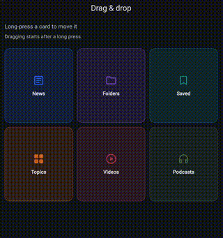

# Flutter drag & drop

Implementation of an "iOS home-screen-style" drag&drop system between widgets.
Long-pressing and dragging a card dynamically repositions the remaining cards
to accommodate its new position.

## Demo

<p align="center">
    
    <br>
    <em>Interactive demonstration of the Drag&Drop effect driven by smooth drag gestures and custom 3D perspective transformations.</em>
</p>

## How to try it

1. Long-press a card to enter edit mode and start dragging it.
2. Move the dragged card over another card; cards reorder live and animate
   into their new positions.
3. Release to finish dragging. Edit mode stays active so you can continue
   moving cards; tap anywhere to exit.

The source card disappears while dragging, and a floating copy follows the
pointer centered under your finger. Reorder updates are limited to one every
400 ms while dragging.

## How the logic works

### State and lifecycle

`DragDropController` maintains the ordered list and the current gesture state:

- `isEditingMode`: whether edit mode is active, enabled by the first drag;
- `isDragging`: whether a drag is currently in progress;
- `draggedItemId`: identifies the card being dragged;
- `sourceIndex` and `targetIndex`: identify the source and destination in the
  grid;
- `dragPosition`: stores the latest global pointer position.

The lifecycle is `startDrag` → `updateDragPosition` / `dropOn` →
`endDrag`. `dropOn` moves the item immediately and updates its source index so
it can continue following the pointer. `endDrag` clears transient gesture data
while keeping edit mode active. `exitEditMode` resets the entire state.

### Flutter widgets

- A long-press gesture starts dragging, while a page-level pointer listener
  tracks movement and release.
- The grid resolves the hovered card from its slot geometry; live reorder
  updates are limited to one every 400 ms and animate the cards into place.
- A floating card preview stays centered under the pointer, and the original
  card is hidden while dragging.
- `AnimatedScale` slightly shrinks cards in edit mode. Tapping anywhere exits
  edit mode.

This demo retains those interaction concepts while removing dependencies on
the rest of the application. Reordering is local and is not persisted or sent
to a backend.

## Project structure

```text
lib/
  drag_drop_controller.dart   # drag-and-drop state and operations
  main.dart                   # demo UI and gesture wiring
test/
  drag_drop_controller_test.dart
```
